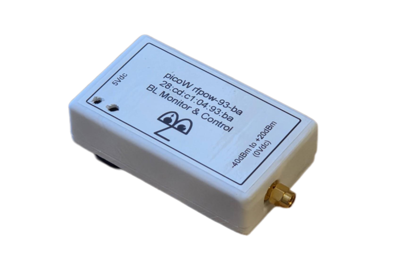

# RF Power Meter Cube

**Compact, wireless RF power measurement for distributed instrumentation and Blinky-Lite control-system deployments.**

## Overview

The RF Power Meter Cube is a dedicated RF measurement node built around the Mini-Circuits ZX47-40LN-S+ logarithmic RF power detector. It is designed for installations where RF power must be measured near the equipment and reported to a central control system without adding a wired data connection.
Using 2.4 GHz Wi-Fi and MQTT publish/subscribe communication, the device sends measurements and alarm conditions to the Blinky-Lite control system as events occur. The platform supports remote deployments, configurable calibration data, and integration with databases, notifications, and machine-protection workflows.

### Key features

- RF measurement: 10 MHz to 8 GHz, with a 60 dB dynamic range of −40 dBm to +20 dBm.
- Compact installation: DIN Mod3-compatible enclosure with a removable DIN-rail mount.
- Wireless connectivity: 2.4 GHz Wi-Fi for distributed measurement points.
- Event-driven integration: MQTT publish/subscribe communication with Blinky-Lite.
- Fast alarm reporting: RF power conditions can be transmitted as soon as configured limits are crossed.
- Configurable calibration: Calibration data can be updated for the required bandwidth and measurement application.
- Open-source firmware: Device microcontroller code can be adapted for site-specific instrumentation and integration needs.

### Technical summary

| Specification    | Details |
| -------- | ------- |
| RF detector  | Mini-Circuits ZX47-40LN-S+ RF power detector   |
| Dynamic range | 60 dB (−40 dBm to +20 dBm)     |
| Frequency range    | 10 MHz to 8 GHz    |
| RF input | SMA male connector |
| Power input | 5 V DC via 2.1 mm barrel connector |
| Wireless | 2.4 GHz Wi-Fi |
| Communication | MQTT publish/subscribe protocol |
| PCB dimensions | 48 mm × 86 mm |
| Enclosure dimensions | 58 mm × 96 mm × 28 mm, with removable DIN-rail mount |
| Platform | Blinky-Lite Instrumentation Platform |

### Typical applications

- RF system commissioning and troubleshooting
- Continuous RF power monitoring at remote equipment locations
- Accelerator, laboratory, and industrial test systems
- Distributed instrumentation deployments requiring central visibility
- RF alarm and machine-protection workflows

## Getting started

### Hardware

1. Install the RF Power Meter Cube near the RF point to be monitored.
2. Connect the RF signal to the SMA input, ensuring the expected input level remains within the supported measurement range.
3. Power the device from a regulated 5 V DC supply through the 2.1 mm barrel connector.
4. Mount the enclosure on a DIN rail when required, or remove the DIN-rail mount for an alternative installation.

### Firmware build target

The firmware targets the RP2040/Pico W environment using the Arduino-Pico board support.
- Board: Pico W / RP2040-compatible target
- Flash layout: Sketch 1920 KB, filesystem 128 KB
- FQBN flash option: flash=2097152_131072

### Configuration

1. Build and upload the firmware using the project’s source and configuration files.
2. Connect to the device’s onboard web interface to set or update Wi-Fi credentials.
3. Configure the MQTT connection and the corresponding Blinky-Lite device integration.
4. Apply the calibration data appropriate to the RF detector, frequency range, and intended measurement bandwidth.
5. Set measurement limits and verify that normal readings and alarm events appear in the control system.

### Integration model

The RF Power Meter Cube uses MQTT to publish measurement and alarm events. This event-driven model avoids conventional polling and enables the control system to react promptly to changing RF conditions.
In a typical deployment, the device connects by Wi-Fi to the network, publishes data to an MQTT broker, and is represented in Blinky-Lite as an integrated instrumentation node. Blinky-Lite can then use the incoming measurements for recording, notification, display, and machine-protection logic.

### Calibration and measurement considerations

- Confirm that the RF signal level and frequency are within the detector’s supported range before connection.
- Use calibration data appropriate to the operating frequency band and required accuracy.
- Validate the installation against a known reference source before relying on readings for protection or operational decisions.
- Review connector, cable, grounding, shielding, and environmental requirements for the installation.

### Support and customisation

Blinky-Lite can support system design, installation, commissioning, custom integration, calibration, and ongoing technical support. The open-source firmware is intended to make site-specific adaptations possible where required.

